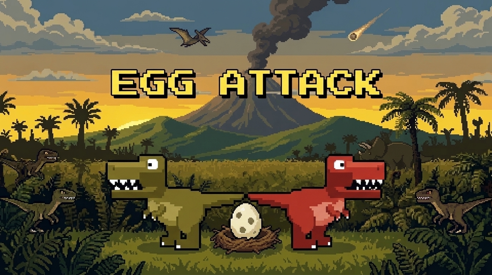
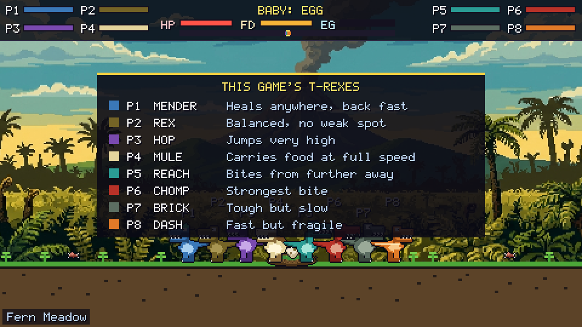
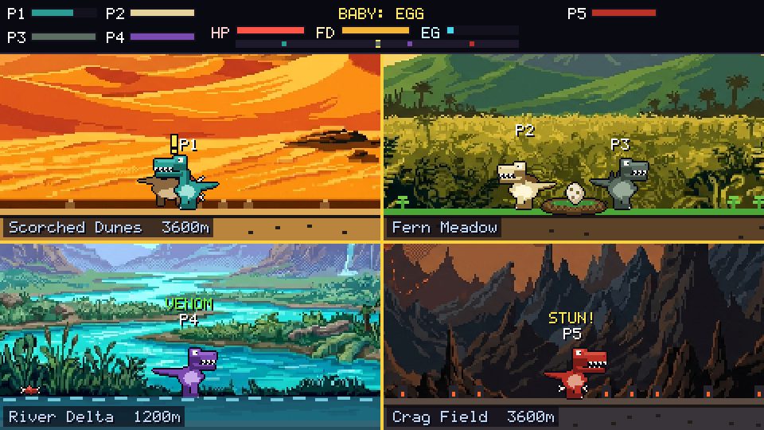
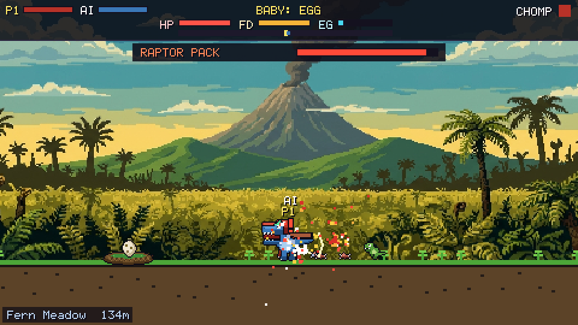
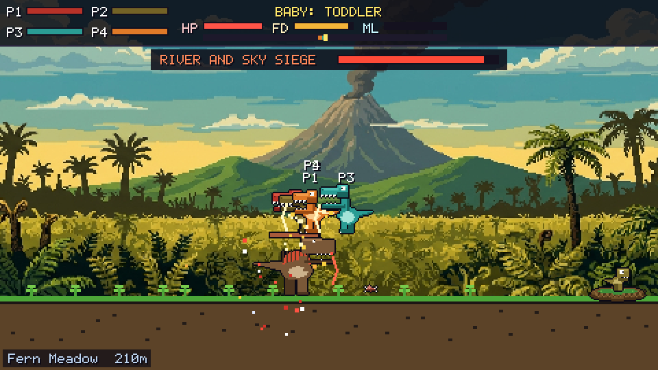
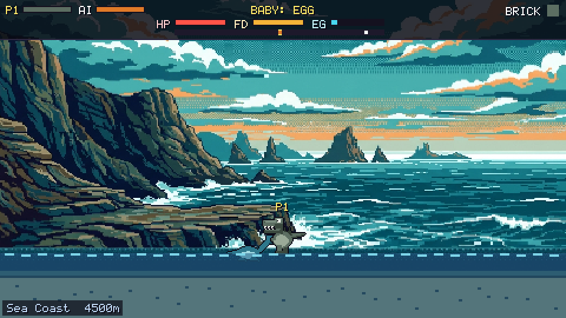
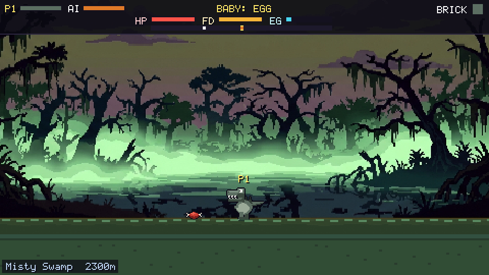
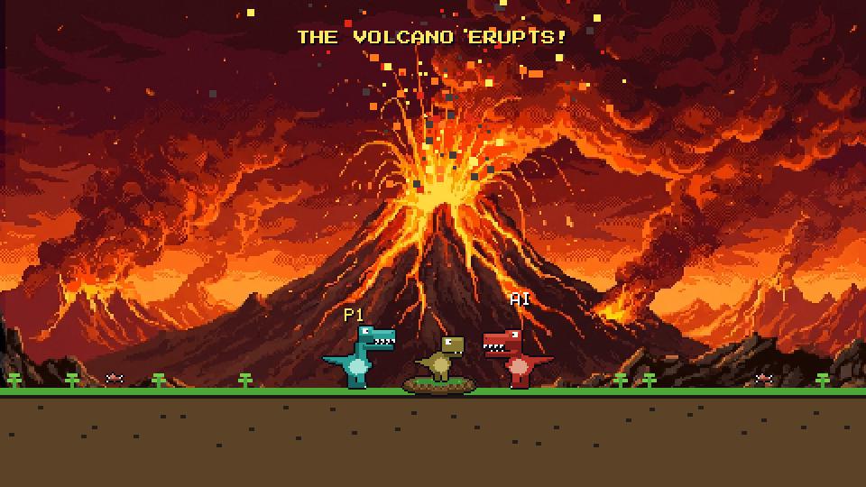
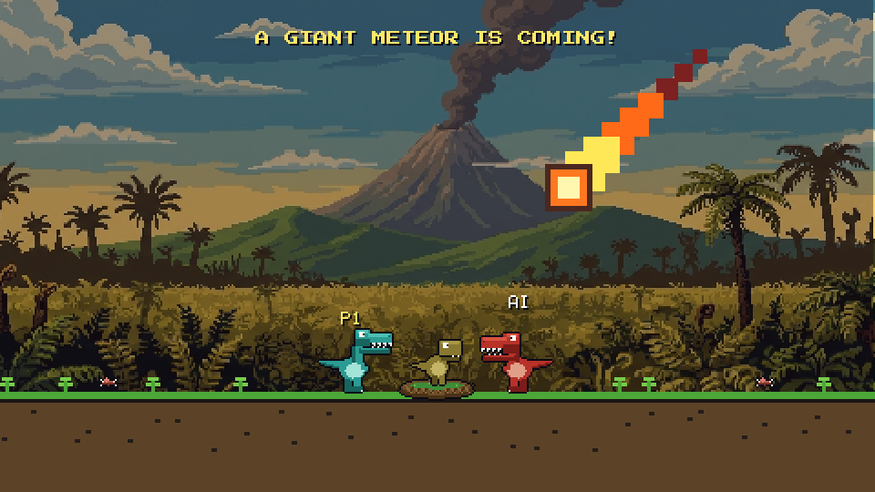

<p align="center">
  
</p>

<h1 align="center">Egg Attack</h1>

<p align="center">
  <b>Guard the egg, feed the baby T-rex, beat the bosses!</b><br>
  A pixel-art game for 1 to 8 players, in the browser and on Windows.
</p>

<p align="center">
  <a href="https://aikkuypers2005.github.io/Egg-Attack/"><b>Play in the browser</b></a>
  &nbsp;·&nbsp;
  <a href="https://github.com/aikkuypers2005/Egg-Attack/releases/latest"><b>Download for Windows</b></a>
</p>

A pixel-art game about a T-rex family guarding their nest, based on the original `tirexs_aik_en_job.pde` sketch by Aik & Job.

The egg sits in the nest in the middle of a long side-scrolling world. You hunt in the biomes to the left and right, carry the meat home, and defend the nest against raids. A boss wave comes every time the baby is ready to grow. When the baby is grown up, the game ends with a volcano eruption or a meteor strike.

## Screenshots

| | |
|:---:|:---:|
| <br>Up to 8 players, each with a different T-rex type | <br>Split screen when players spread out over the world |
| <br>The first boss wave: the Raptor Pack | <br>Four players against the River and Sky Siege |
| <br>The Sea Coast, 4500 m from the nest | <br>Hunting in the Misty Swamp |
| <br>Ending 1: the volcano erupts | <br>Ending 2: the meteor |

The screenshots are from the Windows version; the browser version looks the same. The cover picture is an illustration, not a screenshot.

## How the game works

- **Meals.** Each stage needs 5 meals (more in bigger groups). Only meat from the wild counts, and it has to come from far enough away:

  | Stage | Meat must come from |
  |---|---|
  | Hatchling | Deep Jungle or River Delta |
  | Toddler | Misty Swamp or Mushroom Forest |
  | Juvenile | Scorched Dunes or Crag Field |

  Meat from Bone Canyon or the Sea Coast counts as 2 meals. Meat from raiders is only a snack: it fills hunger, not the meal counter.
- **Bosses.** The egg hatches after a minute, and that brings the first boss wave. Each later stage ends with a bigger one. A boss leader only takes full damage while it is recovering or stunned.
- **Attacks.** Every enemy shows a `!` and winds up before it strikes. Jump or step back, then bite while it recovers. A bite stops a small creature's wind-up.
- **T-rex types.** Every game deals each player a different one of 8 types:

  | Type | Good at |
  |---|---|
  | Rex | Balanced |
  | Brick | Most health, slow |
  | Dash | Fastest, least health |
  | Chomp | Strongest bite |
  | Mule | Carries food at full speed |
  | Hop | Jumps very high |
  | Reach | Bites from further away |
  | Mender | Heals anywhere, back quickly after a knock-out |
- **Ending.** Volcano if the baby took little damage over the whole game, meteor if it took a lot.

## Play in the browser

Play online: https://aikkuypers2005.github.io/Egg-Attack/

Or run it on your own computer:

```powershell
node serve.js
```

Then open http://localhost:8123.

- **Play alone:** you and one T-rex played by the computer.
- **Together on 1 computer:** 2 to 8 players. Each player presses their bite button to join.
- **Online:** one player hosts and gives the 4-letter code to up to 7 others. If a guest leaves, the computer takes over their T-rex. If the host leaves, the game ends.

| Device | Walk | Jump | Bite | Grab or drop |
|---|---|---|---|---|
| Keys 1 | Left, Right | Up | Space | Down |
| Keys 2 | A, D | W | F | S |
| Keys 3 | J, L | I | H | K |
| Keys 4 | Numpad 4, 6 | Numpad 8 | Numpad 0 | Numpad 5 |
| Controller | Stick or D-pad | A | X | B |
| Phone or tablet | Arrow buttons | JUMP | BITE | GRAB |

**On a phone or tablet** the same link works. Buttons appear on the screen, the menus work by tapping, and the game is always shown in landscape: hold the phone sideways. Where the browser allows it (Chrome on Android), the game goes full screen after the first tap. On an iPhone, use Share > Add to Home Screen to play without the browser bars. The touch buttons count as Keys 1.

Most keyboards only register a few keys at once. For 3 or 4 keyboard players, plug in a second USB keyboard. Chrome and Edge accept at most 4 controllers.

## Windows version

`processing/EggAttack` is the same game for Processing 4 (Java mode): play alone or with 2 to 8 players on one computer. It has no online play. Download the installer `EggAttack-Setup-1.1.0.exe` from the [Releases page](https://github.com/aikkuypers2005/Egg-Attack/releases), or open `EggAttack.pde` in Processing and press Run. The installer is not code-signed, so Windows SmartScreen may warn; choose "More info" and then "Run anyway". See `installer/README.md` for how to rebuild it.

## Tests

```powershell
node test/smoke.js          # the rules, the T-rex types, full games with 1 to 8 test players
node tools/fingerprint.js   # scripted games; the Windows version must print the same lines
```

`nettest.html?guests=3` opens a real host and 3 real guests in one page, to test online play.

## Changing the balance

The numbers are at the top of `src/sim.js`: meals per stage (`sim.MEALS`), how the game grows with more players (`sim.MEAL_K`, `sim.BOSS_K`), raids (`RAIDS`, `RAID_GAP`), boss waves (`BOSSES`) and attack timing (`WIND`, `RECO`, `MOVES`). Creature stats, T-rex types, sprites and biomes are in `tools/build_data.js`; run `node tools/build_data.js` after changing them. Rule changes must be repeated in `processing/EggAttack/Sim.pde`.
